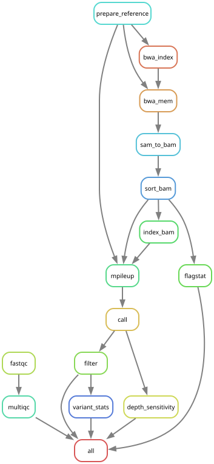

# Documentation

- [Project structure and entry points](structure.md)
- [Resource measurements](hardware.md)
- [Software versions](software-versions.txt) and [citation instructions](citation.md)
- [Licenses and source credits](licenses.md)
- [Analysis decisions](decisions.md) and [project notes](notes.md)

The current Snakemake rule graph is generated from `workflow/Snakefile`:

This is a graph of rule dependencies, not task execution timings. The DOT
source is `rulegraph.dot`; regeneration commands are in `citation.md`.
